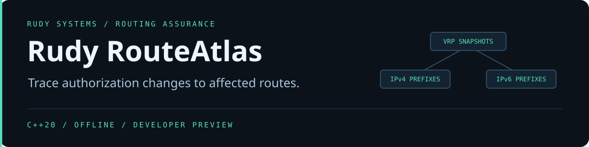

<p align="center"></p>

<p align="center">
<a href="https://github.com/r4venrudy/rudy-routeatlas/actions/workflows/ci.yml"></a>

<a href="LICENSE"></a>
<a href="https://rudy.systems"></a>
</p>

**A change to one VRP can affect every more-specific route it covers.** Rudy RouteAtlas checks an IPv4 and IPv6 inventory against a trusted export of Validated ROA Payloads (VRPs). It explains each origin validation result and compares the impact of two snapshots on the same routes.

## Try the sample

Download a [native preview](https://github.com/r4venrudy/rudy-routeatlas/releases), verify its SHA-256 against the matching entry in `SHA256SUMS.txt`, and extract the package. The examples use documentation prefixes and ASNs.

```sh
bin/routeatlas validate examples/before.csv examples/routes.csv
bin/routeatlas compare examples/before.csv examples/after.csv examples/routes.csv --fail-on-regression
```

Use `bin\routeatlas.exe` on Windows. In the comparison, the authorization for `192.0.2.0/24` drops its maximum length from 26 to 24. That moves the `192.0.2.0/26` route from Valid to Invalid. The AS0 replacement independently moves `198.51.100.0/24` from Invalid to Valid. The report shows both transitions.

## Inputs and evidence

- VRP CSV uses `prefix,maxLength,asn`. Materialize the prefix length as `maxLength` when the source authorization leaves it implicit.
- Route CSV uses `prefix,origin`. Supply a nonzero decimal ASN or `NONE` for an unknown origin.
- Use printable ASCII, LF or CRLF, exact headers, and unquoted comma-separated fields. An input can end with or without a newline. Header-only snapshots and inventories are accepted.
- IPv4 and IPv6 prefixes must have zero host bits. Duplicate rows collapse after address normalization. Each file is bounded to one million rows and 512 bytes per line.

The compressed radix tree visits covering prefixes across both address families. Each occupied node uses binary searches in its sorted ASN and maximum-length records. A route is Valid when any covering VRP authorizes both its origin and length, Invalid when coverage exists without authorization, or NotFound when coverage is absent. AS0 contributes coverage and cannot authorize a route. See [RFC 6811](https://www.rfc-editor.org/rfc/rfc6811.html), [RFC 8481](https://www.rfc-editor.org/rfc/rfc8481.html), and [RFC 7607](https://www.rfc-editor.org/rfc/rfc7607.html).

JSON includes coverage, matching and AS0 counts, a deterministic witness, and a reason code. Valid witnesses prefer the most specific authorizing prefix and then the smallest sufficient maximum length. Maximum-length failures prefer the most specific same-origin prefix and its largest maximum length. Other Invalid witnesses use the most specific covering prefix, then the smallest ASN and maximum length.

Comparison emits a 3 × 3 matrix with rows for the prior state and columns for the new state. The gate orders states as Valid, NotFound, then Invalid, from best to worst. Exit status 1 means a route moved to a worse state while the gate was enabled. Exit 2 signals invalid input, I/O failure, or incorrect usage. A successful report otherwise exits 0.

RouteAtlas performs origin validation against supplied VRPs and origin values. The caller is responsible for snapshot validation, freshness, route inventory provenance, and any operational routing policy.

## Build and test

Use a C++20 compiler and CMake 3.20 or newer. Python 3.9 or newer runs the independent test oracle and packaging script. Set `BUILD_TESTING=OFF` to compile without Python.

```sh
cmake -S . -B build -DCMAKE_BUILD_TYPE=Release
cmake --build build --config Release --parallel 2
ctest --test-dir build -C Release --output-on-failure
cmake --install build --config Release --prefix stage
```

The independent oracle scans VRPs with Python's `ipaddress` module. It checks every generated route's state, counts and witness, then verifies the comparison matrix and gate. CI runs Windows, Linux, macOS, and Linux with AddressSanitizer and UndefinedBehaviorSanitizer.
